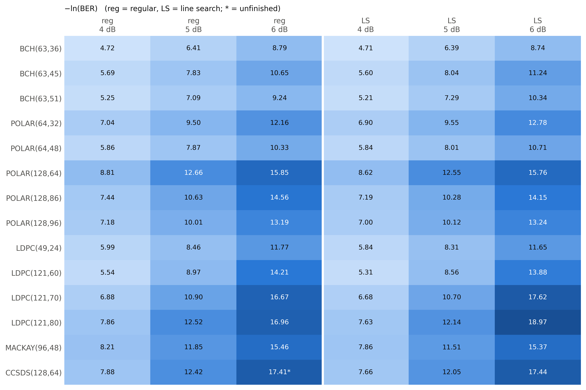
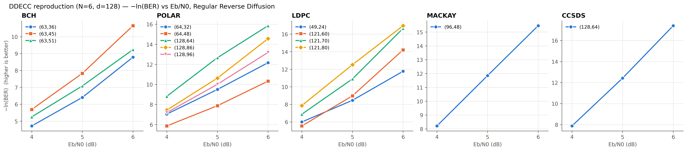
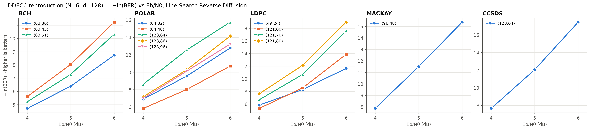
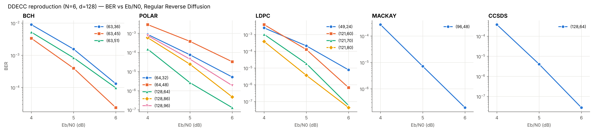
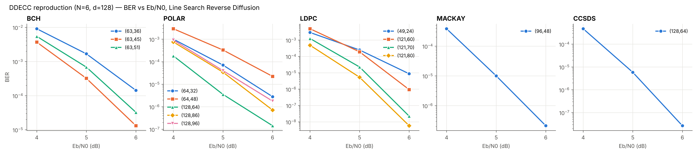
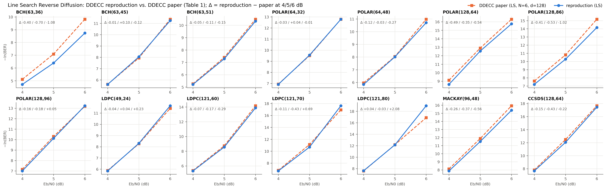
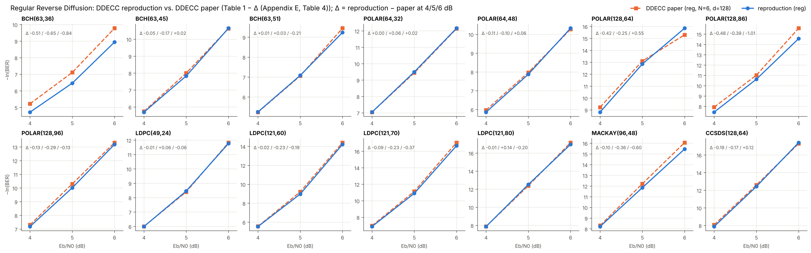

# DDECC reproduction on Colab

Reproduction of **Denoising Diffusion Error Correction Codes** (Yoni Choukroun and Lior Wolf, ICLR 2023)
with the official code at https://github.com/yoniLc/DDECC, run on Google Colab.

All 14 codes of the paper's Table 1 were trained with the paper's largest setting (N = 6, d = 128) and tested at
Eb/N0 = 4, 5 and 6 dB with both reverse-diffusion decoders (regular and line search).
The metric is −ln(BER); higher is better.

**Summary.** For 9 of the 14 codes the reproduction is within ±0.3 of the paper at 4 and 5 dB, for both
decoders. On average it is 0.1–0.2 lower than the paper. The clearest gaps are BCH(63,36) (0.4–1.1 lower at every
point), POLAR(128,86) (up to 1.0 lower at 6 dB) and, to a lesser extent, POLAR(128,64) and MACKAY(96,48)
(0.3–0.6 lower). Several 6 dB points rest on very few frame errors (see [Statistical notes](#statistical-notes)),
so their differences, in both directions, are not reliable.

## Setup

| | value |
|---|---|
| model | DDECC transformer, N = 6 layers, d = 128, h = 8 heads |
| training | 2000 epochs × 1000 batches, batch 128, Adam lr 1e-4 with cosine decay to 5e-6, β (`sigma`) = 0.01, seed 42 |
| channel | BPSK over AWGN, random codewords, test batch 2048 |
| decoders | regular reverse diffusion (`reg`) and line-search reverse diffusion (`LS`, used in the paper's Table 1) |
| Eb/N0 | 4, 5, 6 dB |
| codes | BCH(63,36), BCH(63,45), BCH(63,51), POLAR(64,32), POLAR(64,48), POLAR(128,64), POLAR(128,86), POLAR(128,96), LDPC(49,24), LDPC(121,60), LDPC(121,70), LDPC(121,80), MACKAY(96,48), CCSDS(128,64) |
| hardware | Google Colab GPUs (runs were resumed across sessions) |

Each Eb/N0 point is tested until the frame-error threshold is reached and at least 1e5 frames were decoded, or
until 1e7 frames. Two thresholds were used, depending on where the point was tested (`source` column of
`figures/results.csv`):

| source | frame-error threshold |
|---|---|
| `training_logs/<run>/logging.txt` (the repo's own `Main.py` test) and the notebook's step 5 | > 500 frame errors |
| `test_results/eval_official/`, `test_results/eval_resume/` (resumable re-tests) | > 100 frame errors |

## Results: −ln(BER)

† fewer than 100 frame errors (the point reached 1e7 frames); * unfinished (9.9e6 frames).

### Regular reverse diffusion

| Code | 4 dB | 5 dB | 6 dB |
|---|---|---|---|
| BCH(63,36) | 4.72 | 6.41 | 8.79 |
| BCH(63,45) | 5.69 | 7.83 | 10.65 |
| BCH(63,51) | 5.25 | 7.09 | 9.24 |
| POLAR(64,32) | 7.04 | 9.50 | 12.16 |
| POLAR(64,48) | 5.86 | 7.87 | 10.33 |
| POLAR(128,64) | 8.81 | 12.66 | 15.85 † |
| POLAR(128,86) | 7.44 | 10.63 | 14.56 |
| POLAR(128,96) | 7.18 | 10.01 | 13.19 |
| LDPC(49,24) | 5.99 | 8.46 | 11.77 |
| LDPC(121,60) | 5.54 | 8.97 | 14.21 † |
| LDPC(121,70) | 6.88 | 10.90 | 16.67 † |
| LDPC(121,80) | 7.86 | 12.52 | 16.96 † |
| MACKAY(96,48) | 8.21 | 11.85 | 15.46 † |
| CCSDS(128,64) | 7.88 | 12.42 | 17.41 †* |

### Line-search reverse diffusion

| Code | 4 dB | 5 dB | 6 dB |
|---|---|---|---|
| BCH(63,36) | 4.71 | 6.39 | 8.74 |
| BCH(63,45) | 5.60 | 8.04 | 11.24 |
| BCH(63,51) | 5.21 | 7.29 | 10.34 |
| POLAR(64,32) | 6.90 | 9.55 | 12.78 |
| POLAR(64,48) | 5.84 | 8.01 | 10.71 |
| POLAR(128,64) | 8.62 | 12.55 | 15.76 † |
| POLAR(128,86) | 7.19 | 10.28 | 14.15 |
| POLAR(128,96) | 7.00 | 10.12 | 13.24 |
| LDPC(49,24) | 5.84 | 8.31 | 11.65 |
| LDPC(121,60) | 5.31 | 8.56 | 13.88 |
| LDPC(121,70) | 6.68 | 10.70 | 17.62 † |
| LDPC(121,80) | 7.63 | 12.14 | 18.97 † |
| MACKAY(96,48) | 7.86 | 11.51 | 15.37 † |
| CCSDS(128,64) | 7.66 | 12.05 | 17.44 † |

BER, FER, number of frames, frame errors, the model and the source file of every point are in
[`figures/results.csv`](figures/results.csv).



| | regular | line search |
|---|---|---|
| −ln(BER) vs Eb/N0 |  |  |
| BER vs Eb/N0 |  |  |

## Comparison with the paper (N = 6, d = 128)

Paper values:
- **Line search**: Table 1 of the paper. Each cell of that table lists d = 32 / 64 / 128; the d = 128 value is used.
- **Regular**: the paper has no table for regular decoding, but Appendix E (Table 4) gives
  Δ = −ln(BER_LS) + ln(BER_reg) for all 14 codes, so paper regular = Table 1 − Δ. Both are rounded to 0.01,
  so the derived values are accurate to about ±0.01.

Cells: reproduction / paper (difference); a negative difference means the reproduction is lower (worse).

### Line search (paper Table 1)

| Code | 4 dB | 5 dB | 6 dB |
|---|---|---|---|
| BCH(63,36) | 4.71 / 5.11 (−0.40) | 6.39 / 7.09 (−0.70) | 8.74 / 9.82 (−1.08) |
| BCH(63,45) | 5.60 / 5.61 (−0.01) | 8.04 / 7.94 (+0.10) | 11.24 / 11.36 (−0.12) |
| BCH(63,51) | 5.21 / 5.26 (−0.05) | 7.29 / 7.40 (−0.11) | 10.34 / 10.49 (−0.15) |
| POLAR(64,32) | 6.90 / 6.93 (−0.03) | 9.55 / 9.51 (+0.04) | 12.78 / 12.79 (−0.01) |
| POLAR(64,48) | 5.84 / 5.96 (−0.12) | 8.01 / 8.04 (−0.03) | 10.71 / 10.98 (−0.27) |
| POLAR(128,64) | 8.62 / 9.11 (−0.49) | 12.55 / 12.90 (−0.35) | 15.76 / 16.30 (−0.54) † |
| POLAR(128,86) | 7.19 / 7.60 (−0.41) | 10.28 / 10.81 (−0.53) | 14.15 / 15.17 (−1.02) |
| POLAR(128,96) | 7.00 / 7.16 (−0.16) | 10.12 / 10.30 (−0.18) | 13.24 / 13.19 (+0.05) |
| LDPC(49,24) | 5.84 / 5.88 (−0.04) | 8.31 / 8.27 (+0.04) | 11.65 / 11.42 (+0.23) |
| LDPC(121,60) | 5.31 / 5.38 (−0.07) | 8.56 / 8.73 (−0.17) | 13.88 / 14.17 (−0.29) |
| LDPC(121,70) | 6.68 / 6.79 (−0.11) | 10.70 / 11.13 (−0.43) | 17.62 / 16.93 (+0.69) † |
| LDPC(121,80) | 7.63 / 7.59 (+0.04) | 12.14 / 12.17 (−0.03) | 18.97 / 16.89 (+2.08) † |
| MACKAY(96,48) | 7.86 / 8.12 (−0.26) | 11.51 / 11.88 (−0.37) | 15.37 / 15.93 (−0.56) † |
| CCSDS(128,64) | 7.66 / 7.81 (−0.15) | 12.05 / 12.48 (−0.43) | 17.44 / 17.66 (−0.22) † |
| **mean difference** | **−0.16** | **−0.22** | **−0.09** |



### Regular (paper Table 1 − Appendix E Δ)

| Code | 4 dB | 5 dB | 6 dB |
|---|---|---|---|
| BCH(63,36) | 4.72 / 5.22 (−0.50) | 6.41 / 7.11 (−0.70) | 8.79 / 9.78 (−0.99) |
| BCH(63,45) | 5.69 / 5.74 (−0.05) | 7.83 / 8.00 (−0.17) | 10.65 / 10.63 (+0.02) |
| BCH(63,51) | 5.25 / 5.24 (+0.01) | 7.09 / 7.06 (+0.03) | 9.24 / 9.45 (−0.21) |
| POLAR(64,32) | 7.04 / 7.04 (+0.00) | 9.50 / 9.44 (+0.06) | 12.16 / 12.14 (+0.02) |
| POLAR(64,48) | 5.86 / 5.97 (−0.11) | 7.87 / 7.97 (−0.10) | 10.33 / 10.27 (+0.06) |
| POLAR(128,64) | 8.81 / 9.23 (−0.42) | 12.66 / 13.10 (−0.44) | 15.85 / 15.30 (+0.55) † |
| POLAR(128,86) | 7.44 / 7.92 (−0.48) | 10.63 / 11.02 (−0.39) | 14.56 / 15.57 (−1.01) |
| POLAR(128,96) | 7.18 / 7.31 (−0.13) | 10.01 / 10.30 (−0.29) | 13.19 / 13.32 (−0.13) |
| LDPC(49,24) | 5.99 / 6.00 (−0.01) | 8.46 / 8.40 (+0.06) | 11.77 / 11.83 (−0.06) |
| LDPC(121,60) | 5.54 / 5.56 (−0.02) | 8.97 / 9.20 (−0.23) | 14.21 / 14.40 (−0.19) † |
| LDPC(121,70) | 6.88 / 6.97 (−0.09) | 10.90 / 11.13 (−0.23) | 16.67 / 17.04 (−0.37) † |
| LDPC(121,80) | 7.86 / 7.87 (−0.01) | 12.52 / 12.38 (+0.14) | 16.96 / 17.16 (−0.20) † |
| MACKAY(96,48) | 8.21 / 8.31 (−0.10) | 11.85 / 12.21 (−0.36) | 15.46 / 16.06 (−0.60) † |
| CCSDS(128,64) | 7.88 / 8.07 (−0.19) | 12.42 / 12.59 (−0.17) | 17.41 / 17.29 (+0.12) †* |
| **mean difference** | **−0.15** | **−0.20** | **−0.21** |



### Discussion

- **Close to the paper**: BCH(63,45), BCH(63,51), POLAR(64,32), POLAR(64,48), POLAR(128,96), LDPC(49,24),
  LDPC(121,60) and the 4–5 dB points of LDPC(121,80) are within about ±0.3 for both decoders.
- **Lower than the paper**: BCH(63,36) at every point (−0.4 to −1.1), POLAR(128,86) (−0.4 to −1.0, largest at
  6 dB), POLAR(128,64) at 4–5 dB and MACKAY(96,48) (−0.1 to −0.6). Only one training run per code (seed 42) was
  tested, so part of these gaps may be run-to-run variation; the paper does not report the spread over seeds.
- **Line search vs regular**: as in the paper's Appendix E, line search helps mostly at 6 dB for the BCH and short
  POLAR codes, and is about equal or slightly worse at 4 dB.
- **6 dB points with few errors**: LDPC(121,80) LS (+2.08) and LDPC(121,70) LS (+0.69) are above the paper, but they
  rest on 7 and 11 frame errors in 1e7 frames. They should not be read as better than the paper.

### Statistical notes

- A point that stops at about 100 frame errors has a relative standard error of roughly 10% on the FER (and on
  the BER), i.e. about ±0.1 on −ln(BER); 500 frame errors give about ±0.05.
- Points marked † reached 1e7 frames with fewer than 100 frame errors:
  POLAR(128,64) 6 dB (38 reg / 45 LS), LDPC(121,60) reg 6 dB (88), LDPC(121,70) 6 dB (15 / 11),
  LDPC(121,80) 6 dB (13 / 7), MACKAY(96,48) 6 dB (47 / 52), CCSDS(128,64) 6 dB (23 / 25).
  With 7–25 frame errors the uncertainty is ±0.2 to ±0.4 or more.
- CCSDS(128,64) regular at 6 dB is unfinished (9.9e6 of 1e7 frames); the value so far is shown.

## Models used

One model per code, the `best_model` of these runs (their `logging.txt` is in `training_logs/`):

| Code | training run |
|---|---|
| BCH(63,36) | `BCH__Code_n_63_k_36__04_11_2026_12_08_53` |
| BCH(63,45) | `BCH__Code_n_63_k_45__04_11_2026_17_21_29` |
| BCH(63,51) | `BCH__Code_n_63_k_51__08_11_2026_14_30_48` |
| POLAR(64,32) | `POLAR__Code_n_64_k_32__05_11_2026_05_06_57` |
| POLAR(64,48) | `POLAR__Code_n_64_k_48__05_11_2026_14_20_51` |
| POLAR(128,64) | `POLAR__Code_n_128_k_64__06_11_2026_05_23_48` |
| POLAR(128,86) | `POLAR__Code_n_128_k_86__13_11_2026_01_39_27` |
| POLAR(128,96) | `POLAR__Code_n_128_k_96__14_11_2026_06_09_42` |
| LDPC(49,24) | `LDPC__Code_n_49_k_24__14_11_2026_07_18_20` |
| LDPC(121,60) | `LDPC__Code_n_121_k_60__15_11_2026_06_42_52` |
| LDPC(121,70) | `LDPC__Code_n_121_k_70__15_11_2026_07_53_29` |
| LDPC(121,80) | `LDPC__Code_n_121_k_80__16_11_2026_07_28_54` |
| MACKAY(96,48) | `MACKAY__Code_n_96_k_48__17_11_2026_07_39_14` |
| CCSDS(128,64) | `CCSDS__Code_n_128_k_64__17_11_2026_11_31_16` |

The other folders in `training_logs/` are earlier or interrupted runs of the same codes. The trained weights are
not included because of their size.

## How to reproduce

Open [`DDECC_reproduction.ipynb`](DDECC_reproduction.ipynb) in Colab. All results are written to
`MyDrive/DDECC_results/` on Google Drive, so training and testing survive disconnects.

| step | what it does | GPU |
|---|---|---|
| 1. Setup | mount Drive, settings, helper functions; run this first after every reconnect | no |
| 2. Environment | clone https://github.com/yoniLc/DDECC and apply the patches below | yes |
| 3. Check | which codes are trained and which Eb/N0 points are tested | no |
| 4. Train | train the codes without a model (or those listed in `RETRAIN`); resumes from the last checkpoint | yes |
| 5. Test | test every missing or unfinished point, regular and line search; resumes from the saved counts | yes |
| 6. Results | −ln(BER) tables, `results.csv`, BER and −ln(BER) figures | no |
| 7. Comparison | differences to the paper and the two comparison figures | no |

Settings are at the top of step 1: the 14 codes, N_dec / d_model / heads, epochs, batch size, learning rate, β,
the Eb/N0 points, `TEST_MODES` (`reg`, `LS`) and the stopping rule (`MIN_FER = 500`, `MIN_FRAMES = 1e5`,
`MAX_FRAMES = 1e7`).

Time: training one code takes many hours on a Colab GPU; at 6 dB a test point often needs 1e7 frames, which can take
more than ten hours for the larger codes.

[`scripts/ddecc_all_in_one.py`](scripts/ddecc_all_in_one.py) is a single Colab cell without GPU: it reads
`DDECC_results`, rebuilds the tables, `results.csv`, the figures and the comparison with the paper, and packs
this repository folder.

### Changes to the official code

The model, the loss and the decoders are unchanged. The notebook restores `Main.py` and `DDECC.py` to the original
before patching, and every patch checks that the text it replaces occurs exactly once.

- `Main.py` (training only): `--out_dir` (one fixed folder per run); `--resume` / `--start_epoch` to continue from
  `last_model` (cosine lr fast-forwarded, Adam state and best loss restored); `last_model` saved every 50 epochs with
  safe writes (temp file + rename, retries on Drive errors); `--no_test` so that testing is done by the resumable
  step 5; `torch.load(..., weights_only=False)` for PyTorch ≥ 2.6.
- `DDECC.py`: one reverse step (`p_sample`) indexes the CPU `betas` with a CPU index, which fixes a device error
  that crashed a BCH test.
- Testing (step 5) re-implements the repo's `test()` counting with resumable state. The line search is `DDECC.py`'s
  own procedure (step sizes 1…20, keep the one with the fewest unsatisfied checks) and was checked to give the same
  output as the original code. Each batch's random numbers depend only on (seed, Eb/N0, batch index), so a resumed
  test gives the same result as an uninterrupted one.

## Repository contents

| path | content |
|---|---|
| `DDECC_reproduction.ipynb` | Colab notebook: setup → environment → check → train → test → results → comparison with the paper |
| `scripts/ddecc_all_in_one.py` | one Colab cell (no GPU): check, tables, figures, comparison, packaging |
| `training_logs/<run>/` | `logging.txt` of every training run (plus `last_epoch.txt` for resumed runs) |
| `runner_logs/` | console output of the training runner (`.log`) and completion markers (`.done`) |
| `test_results/eval_official/` | resumable test logs and states, regular `[reg]` and line search `[LS]` |
| `test_results/eval_resume/` | resumable test states for POLAR(128,64) regular and CCSDS(128,64) line search |
| `figures/` | `results.csv`, −ln(BER) and BER figures, the table figure, the comparison with the paper |
| `figures/old/` | an earlier version of the tables and figures, before all points were finished |

## Reference

```bibtex
@inproceedings{choukroun2023denoising,
  title     = {Denoising Diffusion Error Correction Codes},
  author    = {Choukroun, Yoni and Wolf, Lior},
  booktitle = {International Conference on Learning Representations (ICLR)},
  year      = {2023}
}
```

Official code: https://github.com/yoniLc/DDECC
